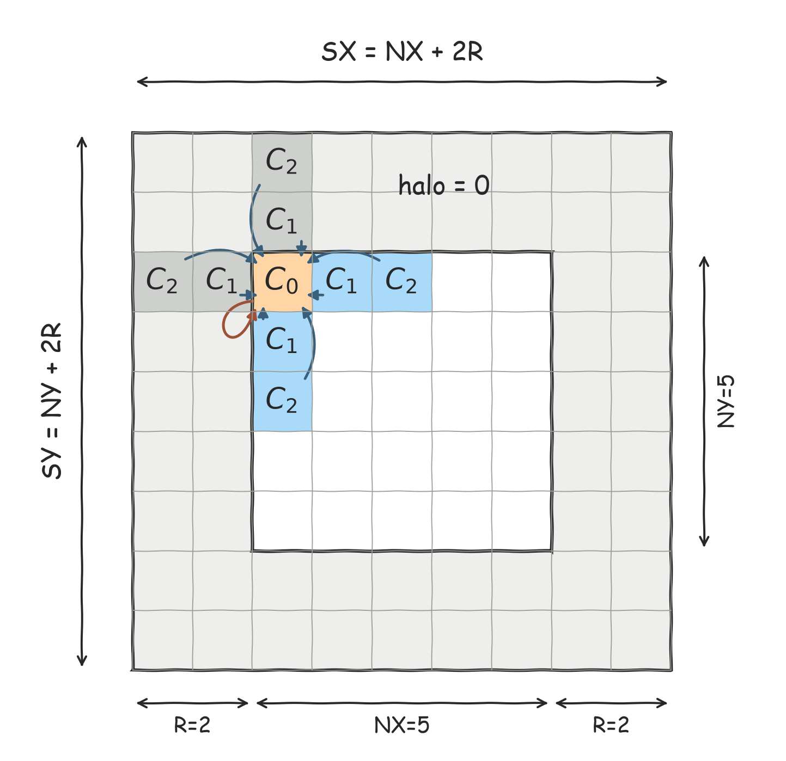

# 并行程序设计 · 第一次作业：使用 OpenMP 并行化 ISO3DFD

## 1. 实验任务说明

三维网格计算广泛用于热传导、浓度扩散等模拟。本次实验使用半径为 8 的 49 点 stencil 进行一阶时间迭代，要求你用 OpenMP 并行化给定程序，并分析进阶优化对性能的影响，掌握线程任务划分、数据依赖与同步的处理方法。

本实验不提供统一软硬件平台。你可以使用任何支持 C99 和 CPU OpenMP 的环境，并在报告中说明实际使用的 CPU、核心数、编译器和编译参数。绝对运行速度不作为评分依据。

随附材料包括待优化源文件、串行基线、自动生成数据并完成验证和计时的外部测试框架，以及实验报告模板。你主要需要修改 `src/iso3dfd_parallel.c`，使用框架完成实验并填写报告。

## 2. 问题介绍

### 2.1 问题背景

本实验计算三维标量场的扩散，数学背景为一阶时间的扩散方程：

$$
\frac{\partial u}{\partial t}
=\kappa\left(\frac{\partial^2u}{\partial x^2}
+\frac{\partial^2u}{\partial y^2}
+\frac{\partial^2u}{\partial z^2}\right).
$$

采用时间一阶、空间 16 阶差分，固定网格间距为 1、$\kappa\Delta t=0.01$，得到

$$
u^{n+1}=u^n+0.01L(u^n).
$$

$L$ 读取当前场的中心及三个坐标轴上距离 1 到 8 的两侧邻居，共 49 个空间点。代码将中心项和步长合并为固定系数 `C[0..8]`，下一步只依赖当前场，具体加权求和见下方伪代码。

### 2.2 计算任务描述

内部网格为 `NX × NY × NZ`。每一维两端各增加 8 层固定零 halo，实际尺寸为 `SX=NX+16`、`SY=NY+16`、`SZ=NZ+16`。仅更新内部点，halo 始终为零。

一个 `float` 数组 `field` 保存内部网格和 halo。内部坐标从 0 开始，`z` 方向连续存储，下标为

```text
idx(x,y,z) = (x+8) × SY × SZ + (y+8) × SZ + (z+8)
```



图：以 `R=2`、`NX=NY=5` 展示固定 `z` 的二维截面。橙色为中心点，蓝色为参与计算的内部邻居，灰色为固定为零的 halo边界，方格内的C0/C1/C2表示其对应的乘加系数，即中心点处在下一个timestep时的值等于9个邻域方格在这一个timestep的值分别乘以对应的系数并求和。实际实验使用三维网格（额外包含 `z` 方向邻居）以及 `R=8`。

从 `field=u^0` 出发执行 `T` 步。函数内部使用当前场 `current` 和临时输出缓冲区 `next`，每一步计算为：

```text
for each interior point (x,y,z):
    i = idx(x,y,z)
    next[i] = C[0] * current[i]
    for r = 1 to 8:
        next[i] += C[r] * (
            current[i+r]       + current[i-r]
          + current[i+r*SZ]    + current[i-r*SZ]
          + current[i+r*SY*SZ] + current[i-r*SY*SZ])
wait until all interior points have been updated
swap(current, next)
```

`C[0]=1+0.01*c[0]`、`C[r]=0.01*c[r]`，其中 `c` 是给定的 16 阶空间差分系数。每步只读当前场，写入临时缓冲区；完成后交换指针。返回时将最终结果 `u^T` 写回 `field`；`T=0` 时输入不变。两个缓冲区的 halo 始终为零。

## 3. 实验代码结构与运行方式

### 3.1 代码结构

```text
assign1-omp/
├── assignment-v2.md
├── 实验报告模板-v2.docx
├── omp实验说明.pptx
├── assets/
│   ├── stencil_2d.png             二维 stencil 示意图
│   └── stencil_2d.svg             示意图矢量版本
└── src/
    ├── iso3dfd_parallel.c         待优化文件：基础并行与进阶优化两个函数
    ├── iso3dfd_serial.c           框架使用的串行基线
    ├── iso3dfd.h                  网格与函数接口
    ├── iso3dfd.c                  框架的数据生成与辅助函数
    ├── verification.c             框架的内置验证用例
    ├── verification.h             验证接口
    └── main.c                     框架入口：生成数据、验证与性能测试
```

你只需关注 `iso3dfd_parallel.c` 中的计算逻辑，以及框架的编译运行方式。可在该文件中添加辅助函数、修改循环组织或使用临时数组；保持给定计算任务和函数接口不变：

```c
RunStats run_parallel_basic(const Grid *g, float *field,
                            int steps, int threads);
RunStats run_parallel_optimized(const Grid *g, float *field,
                                int steps, int threads);
```

分别在 `run_parallel_basic()` 中完成基础并行化，在 `run_parallel_optimized()` 中完成进阶优化，保留两个实现用于对比；两者均放在同一个源文件中。

`field` 既是初始场，也是最终结果的存储位置。`threads` 是请求的线程数；返回值 `threads_used` 应记录实际计算线程组中的 `omp_get_num_threads()`。`Grid` 提供内部尺寸 `nx,ny,nz` 和下标映射 `grid_index()`。单点计算、临时缓冲区和迭代循环均位于待优化文件中，其余文件构成外部测试框架。

### 3.2 编译

在 `assign1-omp` 目录下，GCC 的编译命令为：

```text
gcc -std=c99 -O2 -fopenmp src/main.c src/iso3dfd.c src/verification.c src/iso3dfd_serial.c src/iso3dfd_parallel.c -lm -o iso3dfd
```

使用 MSVC 时，可在开发者命令行中编译：

```text
cl /std:c11 /O2 /openmp src/main.c src/iso3dfd.c src/verification.c src/iso3dfd_serial.c src/iso3dfd_parallel.c /Fe:iso3dfd.exe
```

其他编译器使用对应的 C99 与 OpenMP 选项即可。`collapse` 等扩展特性的可用性取决于编译器；外层循环的 `parallel for` 可以完成基础并行化。

### 3.3 运行

```text
iso3dfd NX NY NZ T THREADS [选项]
```

| 参数或选项 | 含义 |
| --- | --- |
| `NX NY NZ` | 不包含 halo 的内部网格尺寸 |
| `T` | 时间步数 |
| `THREADS` | 请求线程数 |
| `--backend serial\|basic\|optimized` | 选择串行、基础并行或进阶优化，默认 `basic`；串行使用 1 线程 |
| `--init zero\|impulse\|random` | 数据生成方式，默认 `random` |
| `--seed S` | 随机种子，默认 123 |
| `--repeat R` | 正式运行次数，默认 3 |
| `--schedule static\|dynamic\|guided` | 运行时调度策略，默认 `static` |
| `--chunk C` | 调度块大小，默认 0 表示运行时默认值 |

默认生成确定性的随机初始场；也可选择全零场或中心脉冲。无需准备输入文件。以下命令分别测量三个实现，并展示一种调度设置：

```text
./iso3dfd 64 64 64 64 1 --backend serial
./iso3dfd 64 64 64 64 2 --backend basic
./iso3dfd 64 64 64 64 2 --backend optimized
./iso3dfd 64 64 64 64 2 --backend optimized --schedule dynamic --chunk 1
```

可执行文件路径按本机命令行规则调整。调度参数需要 OpenMP 3.0 及以上的运行时接口，且只对 `schedule(runtime)` 的循环生效；较早的运行时可在源码中指定调度方式，再重新编译对应版本。`./iso3dfd --check-only` 可单独验证两个并行函数。

框架自动执行内置用例，并在**每次正式运行前**验证本次输入的计算结果；验证失败时打印错误并立即终止实验。正常输出包含验证日志、实际线程数、每次时间、中位时间及更新吞吐率。记录这些输出即可，无需自行编写验证和计时代码。

## 4. 实验要求

**阶段 1：基础并行化与正确性验证。** 在 `run_parallel_basic()` 中使用 OpenMP 分配空间网格的计算任务，处理共享数据、线程私有变量和跨时间步同步，运行框架完成验证。

**阶段 2：进阶优化与性能测试。** 在 `run_parallel_optimized()` 中比较至少两种调度或任务划分设置，并尝试至少一种进一步优化，例如循环合并、持续线程组、索引简化或空间分块。比较串行、基础并行和进阶优化的结果，结合图表分析性能与加速比。优化未带来加速时也应据实说明。

**优化范围。** 本实验考察 OpenMP 程序设计与优化能力，优化应保持逐时间步的 stencil 计算行为。请勿使用 FFT 替代 stencil、改写为重复 SpMV 或矩阵快速幂求解、直接求热平衡稳态等方式替代给定计算。若不确定某种方法是否属于课程实验的合理范围，请询问老师或助教。

建议从以下规模中选择至少两种，可按实际资源调整：

| 规模 | 内部网格 | 时间步 T |
| --- | --- | ---: |
| 小 | `32×32×32` | 32 |
| 中 | `64×64×64` | 64 |
| 大 | `128×128×128` | 64 |

线程数可选 1、2、4、8 等，以实际可用资源为准。使用相同输入比较不同版本；加速比为串行时间除以并行时间。报告的具体内容见随附模板。

对基础并行和进阶优化分别进行强、弱可扩展性测试，按实际线程数 P 统计：

- **强可扩展性：** 固定网格和 T，增加 P，报告时间和强扩展加速比，以同一并行函数的 1 线程时间为基准。
- **弱可扩展性：** 固定 T，使内部网格点数与 P 成正比，保持每线程工作量不变，报告时间和弱扩展效率 `t(1)/t(P)`。例如 P=1、2、4 时分别使用 `32×32×32`、`64×32×32`、`64×64×32`，T 保持相同。

**AI 使用说明。** 允许使用 AI 辅助生成文本和代码，但你需要理解所采用的优化方法与实验结果，并对提交内容负责。报告中应单列小节，说明 AI 生成内容的使用位置和使用方式；未使用时注明。报告评价重视你自己的思路和有实验依据的结论，无需追求文字包装。鼓励在实验总结中记录与 AI 的交流过程及遇到的问题。

## 5. 参考内容和评分标准

参考 [实验报告模板](实验报告模板-v2.docx)，简要说明并行方法、实验复现指令、性能结果与分析、实验总结及 AI 使用情况。

提交包含两个并行函数的 `iso3dfd_parallel.c`、实验报告和原始运行日志；如有新增辅助文件，一并提供。打包命名为 `学号-姓名-OpenMP实验.zip`，并在**2026年11月14日23:59(AOE时间)前发送至邮箱sls_ustc@mail.ustc.edu.cn**，邮件标题命名为`学号-姓名-OpenMP实验`。若重复提交，则以deadline前最后一次提交的结果为准。

| 评分项目 | 分值 | 评价依据 |
| --- | ---: | --- |
| 正确性 | 30 | 框架验证通过，计算任务与接口保持一致 |
| 并行方法 | 25 | 任务分配、依赖与同步处理、实际 OpenMP 并行计算 |
| 优化与实验 | 20 | 基础与进阶版本对比，强弱可扩展性测试，合理的结果分析 |
| 报告 | 25 | 方法说明、可复现指令、图表与总结、AI 使用说明 |

不按绝对速度评分。使用真实实验数据，确保能够解释自己的代码、优化方法和结论。
